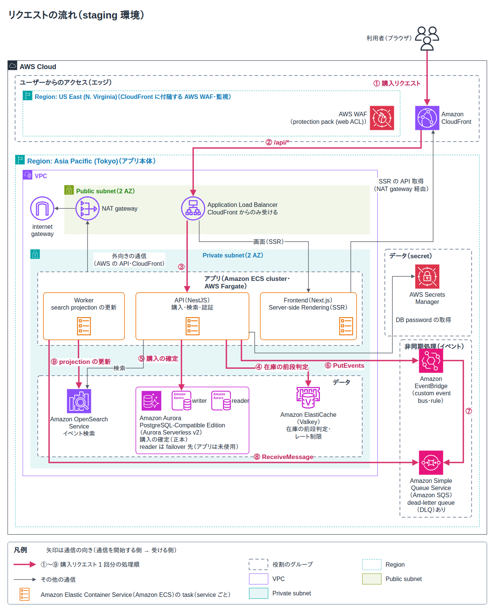
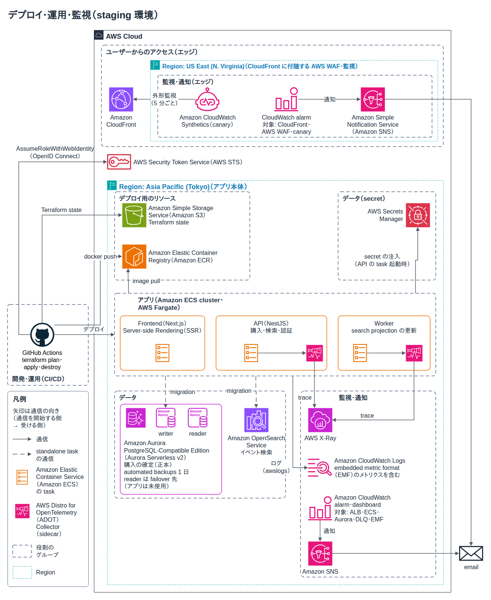

# ticket-c2c-platform

人気イベントの販売開始時に集中する購入リクエストの下で在庫超過を防ぐ、チケット販売の在庫購入基盤を AWS 上に構築し、staging 環境で負荷試験と failover を検証したリポジトリです。
現在は B2C 一次販売への転換方針（[ADR-0020](docs/adr/0020-reframe-as-b2c-primary-ticketing.md)）に沿って目標設計を確定した段階で、B2C 目標構成は未実装です。

## Architecture



①〜⑨ は購入リクエスト 1 回分の処理順です。CloudFront + AWS WAF → ALB → ECS Fargate 上の API が、在庫を ElastiCache (Valkey) で前段判定して Aurora PostgreSQL Serverless v2 で確定し、確定後のイベントを EventBridge → SQS → Worker で OpenSearch に反映します。画面は同じ CloudFront 配下の Next.js SSR で配信します。



GitHub Actions が OpenID Connect で AWS に認証して Terraform の apply / destroy とデプロイを実行し、CloudWatch・X-Ray・Synthetics canary の監視結果は Amazon SNS からメールで通知します。

## Tech Stack

- **Backend**: NestJS（Fastify）/ TypeScript / TypeORM migrations
- **Frontend**: Next.js（App Router / SSR）/ React / Tailwind CSS
- **Infra**: Terraform / Amazon ECS on AWS Fargate / Aurora PostgreSQL / ElastiCache (Valkey) / OpenSearch Service / EventBridge / SQS
- **CI/CD**: GitHub Actions（AWS への認証は GitHub OIDC）/ k6 / Playwright

## Highlights

- **在庫超過 0 件**: staging（本番寄せ構成）で hot event の在庫 6,000 を k6 の spike で売り切り、全 6 event で `remainingQuantity` が負値にならないことを確認しました（[staging 検証記録](docs/architecture/staging-environment-verification-log.md)）。
- **売り切れ後の DB 保護**: dev の sold-out spike で 12,001 リクエストすべてを Valkey の前段フィルタで拒否し、Aurora への到達は 0 件、p50 10.7ms でした（[スパイク PoC 結果](docs/poc/spike-poc-results.md)）。
- **レイテンシ**: staging の baseline（20 req/s）で p95 68.7ms、エラー率 0% でした。一方 hot event へ 200 req/s を集中させると pg pool が枯渇し p95 7.4〜7.5s まで劣化することも実測し、容量計画の課題として記録しています（[staging 検証記録](docs/architecture/staging-environment-verification-log.md)）。
- **failover**: Aurora reader failover（AWS 側の切替約 35〜39 秒）で、アプリ観測の断時間を修正前の約 84.2 秒から修正後は約 4.4 秒以下（2 回目は単発 0.5 秒のブリップのみ）へ短縮しました。Valkey の automatic failover（切替約 30 秒）では断時間約 18.2 秒で自動復旧しました（[staging 検証記録](docs/architecture/staging-environment-verification-log.md)）。
- **IaC とコスト**: dev / staging を Terraform で環境単位に管理し、使わない期間は destroy します。apply / deploy / destroy は GitHub Actions から GitHub OIDC で実行し、長期アクセスキーを使いません（[dev 環境設計](docs/architecture/dev-environment.md)）。

## Getting Started

Node.js / Terraform のバージョンは `.mise.toml` に従います（`mise install`）。

```bash
cp .env.example .env
docker compose up -d                 # PostgreSQL / Valkey
npm ci
npm run migration:run:local          # TypeORM migrations を適用
npm run start:dev                    # API: http://localhost:3000/healthz
```

フロントエンドは別ターミナルで起動します。

```bash
cd frontend && npm ci
API_BASE_URL=http://localhost:3000 API_PROXY_TARGET=http://localhost:3000 npm run dev -- -p 3001
```

## Documentation

- [システム要件](docs/requirements/system-requirements.md)
- [技術スタック](docs/architecture/technology-stack.md)
- [dev 環境設計](docs/architecture/dev-environment.md) / [staging 環境設計](docs/architecture/staging-environment.md)
- [ADR 一覧](docs/adr/README.md)
- [Production Readiness バックログ](docs/architecture/production-readiness.md)
- [Runbooks](docs/runbooks/)
- [開発フロー（CONTRIBUTING）](CONTRIBUTING.md)
